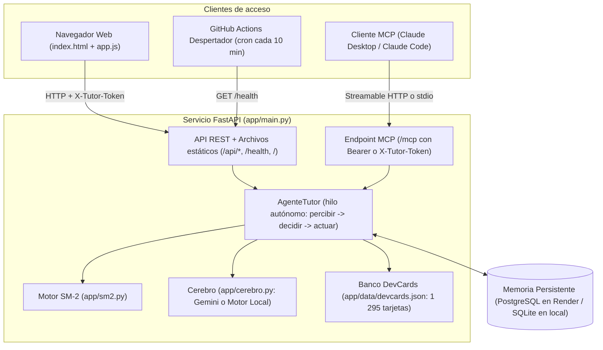

# Agente Tutor Persistente

Agente autónomo de estudio con memoria duradera en base de datos, repetición espaciada (**SM-2**), banco integrado de **1 295 tarjetas técnicas (DevCards)** en **42 categorías** y servidor **MCP** (*Model Context Protocol*). A diferencia de un chat sin estado que olvida al cerrar la pestaña, el agente mantiene un ciclo continuo en segundo plano (**percibir → decidir → actuar**) y retoma exactamente donde estaba después de cualquier reinicio o despliegue.

---

## Por qué es un agente persistente (las 6 pruebas)

1. **Ciclo autónomo en segundo plano (`app/agente.py`)**: Al arrancar FastAPI, `AgenteTutor` inicia un hilo en segundo plano que despierta cada `TUTOR_INTERVALO_S` segundos, inspecciona qué temas vencieron o qué mazos activos tienen tarjetas nuevas, prioriza por retraso y dificultad (`dias_retraso + 2 * (2.5 - facilidad) + 0.5 * fallos`) y prepara preguntas pendientes hasta `TUTOR_MAX_PENDIENTES`.
2. **Memoria duradera en PostgreSQL / SQLite (`app/memoria.py`)**: Todo el conocimiento operativo (tablas `temas`, `preguntas`, `respuestas`, `mazos`, `bitacora` y `latido`) vive en base de datos mediante SQLAlchemy Core. Al volver a encenderse tras un reinicio o fallo, el proceso incrementa `latido.arranques`, consulta `temas` y `pendientes`, y registra en `bitacora`: *«Desperté por N.ª vez. Recuerdo X temas, Y preguntas pendientes y Z ciclos de trabajo»*.
3. **Bitácora auditable de decisiones (`tabla bitacora`)**: Cada arranque (`sistema`), ciclo (`ciclo`), criterio de selección (`decision`), generación (`pregunta`), calificación (`evaluacion`) o incidente (`error`) queda guardado con marca temporal UTC. En la interfaz web, cada pregunta pendiente muestra además el campo `motivo` explicando por qué el agente decidió hacerla ahora.
4. **Planificación adaptativa con SM-2 (`app/sm2.py`) y lectura guiada previa**: Cada DevCard nueva exige leer primero su ficha completa (título, definición, analogía, ejemplo de código e idea clave) antes de desbloquear la pregunta (`TUTOR_LEER_ANTES=1`), mientras que en repasos siguientes pregunta directo. Cada respuesta se evalúa de `0` a `5` (con Gemini o con el motor determinista local cuando no hay clave o conexión). El algoritmo **SuperMemo 2** recalcula `repeticiones`, `facilidad` (mínimo `1.3`) e `intervalo_dias`, y programa `proximo_repaso` en la base de datos. Con `TUTOR_MINUTOS_POR_DIA=1`, un «día» de repaso dura 1 minuto para demostrar el retorno de temas en clase.
5. **Interoperabilidad por MCP (`app/mcp_tools.py`)**: La misma memoria persistente queda expuesta como servidor MCP tanto en modo remoto (**Streamable HTTP** en `/mcp`) como en modo local (**stdio** con `python -m app.mcp_tools`), compartiendo el mismo estado con la web.
6. **Disponibilidad 24/7 en Render + GitHub Actions (`render.yaml` + `.github/workflows/despertador.yml`)**: En Render se despliega el servicio web conectado a una base **PostgreSQL** (`tutor-memoria`), y el flujo programado de GitHub Actions visita `GET /health` cada 10 minutos para evitar que el plan gratuito suspenda el contenedor tras 15 minutos de inactividad.

---

## Arquitectura del sistema



---

## Cómo ejecutarlo en local

### Opción 1: Entorno virtual Python (`.venv`)

Requiere Python 3.12+ (en este repositorio el entorno `.venv` ya incluye las dependencias de `requirements.txt` y `requirements-dev.txt`):

```powershell
# 1. Crear o activar el entorno virtual (Windows PowerShell)
python -m venv .venv
.\.venv\Scripts\Activate.ps1
pip install -r requirements.txt

# 2. (Opcional) Configurar modo demo rápido en clase: 1 "día" SM-2 = 1 minuto
$env:TUTOR_MINUTOS_POR_DIA = "1"
$env:TUTOR_INTERVALO_S = "15"
# Opcional: $env:GEMINI_API_KEY = "tu_clave"
# Opcional: $env:TUTOR_TOKEN = "clave-secreta"

# 3. Levantar el servidor web y el hilo autónomo del agente
uvicorn app.main:app --host 127.0.0.1 --port 8000 --reload
```

Abre `http://127.0.0.1:8000/` en tu navegador. La documentación interactiva OpenAPI queda disponible en `http://127.0.0.1:8000/docs`.

Para ejecutar la suite de pruebas automatizadas:

```powershell
pytest -q
```

### Opción 2: Docker Compose (servidor + PostgreSQL 16)

`docker-compose.yml` levanta el contenedor Python (`tutor`) junto a una base `postgres:16-alpine` con volumen persistente `memoria`:

```powershell
docker compose up --build
```

La aplicación queda escuchando en `http://localhost:8001` (puerto configurable con `TUTOR_PUERTO`; el 8001 evita chocar con otros proyectos que usan el 8000). Los datos sobreviven aunque detengas y vuelvas a iniciar los contenedores (`docker compose down` sin `-v` y luego `docker compose up`).

---

## Cómo desplegarlo en Render paso a paso

> ¿Primera vez desplegando en Render? Consulta la **[guía paso a paso para principiantes](docs/GUIA_RENDER.md)** (desde crear la cuenta hasta activar el despertador y comprobar el reinicio en clase).

El archivo `render.yaml` define el Blueprint completo (`agente-tutor-persistente` + base PostgreSQL `tutor-memoria`):

1. Sube este repositorio a tu cuenta de GitHub.
2. En [Render](https://render.com/), ve a **New > Blueprint** y selecciona tu repositorio.
3. Render leerá `render.yaml` y creará automáticamente:
   - El servicio web Python 3.12.8 (`agente-tutor-persistente`) con `uvicorn app.main:app --host 0.0.0.0 --port $PORT`.
   - La base de datos PostgreSQL `tutor-memoria` conectada por `DATABASE_URL`.
   - Una clave segura generada automáticamente en `TUTOR_TOKEN`.
4. Durante la pantalla de configuración del Blueprint:
   - Introduce `GEMINI_API_KEY` si deseas preguntas y evaluaciones redactadas con Gemini (puedes dejarla vacía para usar el motor local y DevCards).
   - Consulta el valor generado para `TUTOR_TOKEN` en **Environment** del servicio en Render; ese será tu token para escribir desde la web o conectar por MCP.
5. Activa el **despertador 24/7** en GitHub Actions (`.github/workflows/despertador.yml`):
   - En tu repositorio de GitHub ve a **Settings > Secrets and variables > Actions > Variables**.
   - Crea la variable `TUTOR_URL` con la URL pública sin barra final, por ejemplo: `https://agente-tutor-persistente.onrender.com`.
   - El workflow ejecutará `curl "$TUTOR_URL/health"` cada 10 minutos para evitar la suspensión del plan gratuito de Render.

---

## Cómo conectar Claude Desktop o Claude Code por MCP

El agente expone **9 herramientas MCP** sobre la misma base de datos que la interfaz web:

| Herramienta | Propósito |
|---|---|
| `agregar_tema` | Registra un tema propio (`nombre`, `notas`) para el próximo ciclo autónomo. |
| `ver_preguntas_pendientes` | Lista las preguntas pendientes (incluyendo `requiere_lectura` y `lectura` si aplica) sin revelar la respuesta esperada. |
| `marcar_tarjeta_leida` | Marca una tarjeta nueva como leída (`pregunta_id`) para habilitar su pregunta. |
| `responder_pregunta` | Envía la respuesta de la persona (`pregunta_id`, `respuesta`) y recalcula SM-2. |
| `ver_mazos` | Lista las 42 categorías de DevCards con conteo de tarjetas y estado activo. |
| `activar_mazo` | Activa o pausa una categoría DevCards por su nombre exacto. |
| `ver_progreso` | Devuelve temas, dominados, porcentaje de aciertos y temas más difíciles. |
| `ver_estado` | Reporta `vivo`, `ciclos`, `arranques`, cerebro activo y configuración. |
| `ver_bitacora` | Lee las últimas entradas registradas por el agente en `bitacora`. |

### Conexión remota a Render (Streamable HTTP)

El endpoint es `https://<tu-servicio>.onrender.com/mcp` y requiere la cabecera `Authorization: Bearer <TUTOR_TOKEN>` (o `X-Tutor-Token`).

En **Claude Code**, registra el servidor remoto con:

```bash
claude mcp add --transport http agente-tutor https://<tu-servicio>.onrender.com/mcp --header "Authorization: Bearer TU_TUTOR_TOKEN"
```

### Conexión local por `stdio`

Para clientes locales como **Claude Desktop**, añade una entrada en `claude_desktop_config.json` apuntando al intérprete Python del entorno virtual del proyecto:

```json
{
  "mcpServers": {
    "agente-tutor": {
      "command": "C:\\Users\\POWER\\Documents\\GitHub\\agente-tutor-persistente\\.venv\\Scripts\\python.exe",
      "args": ["-m", "app.mcp_tools"],
      "env": {
        "PYTHONPATH": "C:\\Users\\POWER\\Documents\\GitHub\\agente-tutor-persistente",
        "DATABASE_URL": "sqlite:///C:/Users/POWER/Documents/GitHub/agente-tutor-persistente/tutor.db",
        "TUTOR_MINUTOS_POR_DIA": "1"
      }
    }
  }
}
```

> Claude Desktop no permite fijar la carpeta de trabajo: por eso `PYTHONPATH` apunta al proyecto y `DATABASE_URL` usa una ruta absoluta (con una ruta relativa abriría otra base de datos).
>
> Nota: En modo `stdio`, si el servidor web no está corriendo en paralelo, `ver_preguntas_pendientes` ejecuta automáticamente `agente.ciclo()` antes de responder. Si compartes el mismo archivo SQLite o la misma URL de PostgreSQL con el servidor web local, ambos ven exactamente los mismos temas y preguntas.

---

## Variables de entorno (`app/config.py`)

| Variable | Por defecto | Descripción |
|---|---|---|
| `DATABASE_URL` | `sqlite:///./tutor.db` | Cadena SQLAlchemy (`postgres://` y `postgresql://` se adaptan automáticamente a `postgresql+psycopg://`). |
| `GEMINI_API_KEY` | `""` | Clave opcional de Google AI Studio. Sin clave (o ante fallo de red), opera el motor determinista local. |
| `GEMINI_MODEL` | `gemini-2.5-flash` | Modelo de Gemini utilizado por `Cerebro`. |
| `TUTOR_INTERVALO_S` | `30` | Segundos entre ciclos autónomos del hilo de fondo (en `render.yaml`: `20`). |
| `TUTOR_MINUTOS_POR_DIA` | `1440` | Duración en minutos de un «día» SM-2 (`1440` = tiempo real; `1` = modo demo en vivo). |
| `TUTOR_MAX_PENDIENTES` | `3` | Máximo de preguntas pendientes simultáneas que genera el agente. |
| `TUTOR_NUEVAS_POR_DIA` | `5` | Límite de tarjetas DevCards nuevas introducidas por «día» de estudio. |
| `TUTOR_LEER_ANTES` | `1` | Exige leer la ficha de la DevCard nueva antes de responder (`0` desactiva este modo). |
| `TUTOR_TOKEN` | `""` | Clave opcional exigida en `X-Tutor-Token` o `Authorization: Bearer` para rutas de escritura y `/mcp`. |
| `TUTOR_AUTONOMO` | `1` | Pon `"0"` para desactivar el hilo autónomo en pruebas o entornos controlados. |

---

## Contrato API y privacidad

- Cómo funciona el programa por dentro (recorrido, conexiones y preguntas frecuentes): [`docs/COMO_FUNCIONA.md`](docs/COMO_FUNCIONA.md)
- Especificación técnica de endpoints: [`docs/CONTRATO_API.md`](docs/CONTRATO_API.md)
- Casos de uso y diagramas: [`docs/CASOS_DE_USO.md`](docs/CASOS_DE_USO.md)
- Guion de exposición en clase: [`docs/GUION_EXPOSICION.md`](docs/GUION_EXPOSICION.md)
- Política de privacidad servida por la app: [`app/static/privacidad.html`](app/static/privacidad.html) (`/privacidad`)

---

## Créditos

- Banco de **1 295 tarjetas DevCards** adaptado de [`github.com/Mileidys10/devcards_ai`](https://github.com/Mileidys10/devcards_ai) bajo **licencia MIT**.
- Algoritmo de repetición espaciada basado en **SM-2 (SuperMemo 2)**.
