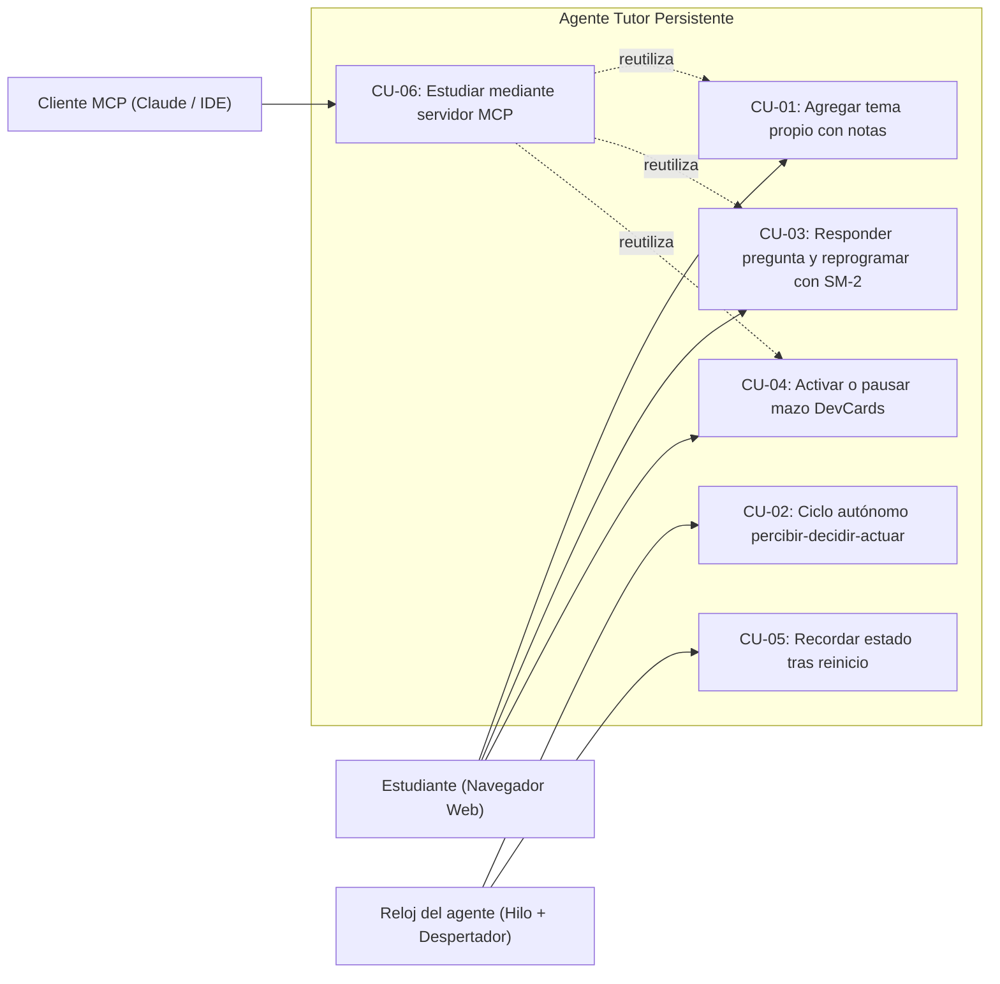
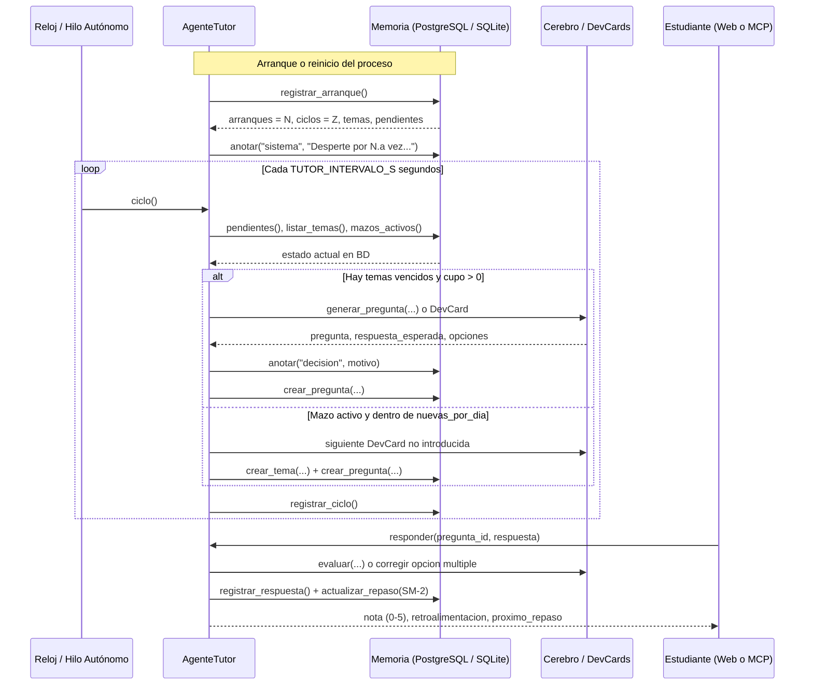

# Casos de Uso — Agente Tutor Persistente

Este documento especifica los actores, flujos principales, flujos alternos y diagramas de comportamiento del **Agente Tutor Persistente** a partir de su implementación real (`app/main.py`, `app/agente.py`, `app/memoria.py`, `app/sm2.py` y `app/mcp_tools.py`).

---

## 1. Actores del sistema

| Actor | Tipo | Descripción |
|---|---|---|
| **Estudiante** | Humano | Persona que utiliza la interfaz web (`/`) para registrar temas con notas, activar mazos de DevCards, responder preguntas pendientes y consultar su progreso y bitácora. |
| **Reloj del agente** | Sistema interno / Cron | Hilo autónomo en segundo plano que despierta cada `TUTOR_INTERVALO_S` segundos (respaldado en Render por `.github/workflows/despertador.yml` con `GET /health` cada 10 minutos). |
| **Cliente MCP** | Agente / Cliente externo | Aplicación compatible con *Model Context Protocol* (Claude Desktop, Claude Code, CLI/IDE) conectada por Streamable HTTP (`/mcp`) o `stdio` (`python -m app.mcp_tools`). |

---

## 2. Diagrama de casos de uso

---

## 3. Especificación de casos de uso

### CU-01: Agregar tema propio con notas de estudio

- **Actor principal**: Estudiante (o Cliente MCP mediante `agregar_tema`).
- **Precondiciones**: El servidor está en ejecución. Si `TUTOR_TOKEN` está definido, el cliente envía la clave válida en `X-Tutor-Token` o `Authorization: Bearer`.
- **Flujo principal**:
  1. El estudiante introduce un nombre (`2–200` caracteres) y notas de estudio (hasta `8 000` caracteres) en el formulario **«Mis temas»** y pulsa **«Agregar tema»**.
  2. La web envía `POST /api/temas` con `{nombre, notas}`.
  3. `AgenteTutor.agregar_tema` almacena el registro en la tabla `temas` (`origen="usuario"`, `repeticiones=0`, `intervalo_dias=0.0`, `facilidad=2.5`, `proximo_repaso=ahora()`).
  4. El agente registra en `bitacora` (tipo `sistema`): *«Aprendí un tema nuevo: «Nombre». Lo preguntaré en mi próximo ciclo.»*
  5. El servidor responde `201 Created` con el tema creado y la web actualiza la lista.
- **Flujos alternos**:
  - **401 Unauthorized**: Falta `TUTOR_TOKEN` o es incorrecto; la web abre el diálogo de clave de acceso, la valida con `GET /api/acceso` y reintenta el envío.
  - **409 Conflict**: Ya existe un tema de usuario con el mismo nombre (comparación insensible a mayúsculas); se informa al estudiante sin duplicar datos.
  - **422 Unprocessable Entity**: El nombre tiene menos de 2 caracteres o supera los límites permitidos.
- **Postcondición**: El tema queda vencido desde el momento de su creación (`proximo_repaso <= ahora`) para ser priorizado en el siguiente ciclo.

---

### CU-02: Ciclo autónomo percibir-decidir-actuar

- **Actor principal**: Reloj del agente (también ejecutable manualmente en demo con `POST /api/ciclo`).
- **Precondiciones**: `AgenteTutor` cuenta con memoria inicializada y espacio disponible por debajo de `TUTOR_MAX_PENDIENTES` (por defecto `3`).
- **Flujo principal**:
  1. **Percibir**: El hilo autónomo obtiene las preguntas pendientes (`pendientes`), los temas cuyo `proximo_repaso <= ahora()` sin pregunta pendiente (`vencidos`) y el cupo restante (`max_pendientes - len(pendientes)`).
  2. **Decidir (repasos)**: Ordena los temas vencidos por prioridad descendente:
     `prioridad = dias_retraso + 2 * (2.5 - facilidad) + 0.5 * fallos`.
  3. **Decidir (DevCards nuevas)**: Si sobra cupo, existen mazos activos en la tabla `mazos` y las tarjetas introducidas en los últimos `TUTOR_MINUTOS_POR_DIA` minutos son menores que `TUTOR_NUEVAS_POR_DIA` (por defecto `5`), selecciona la siguiente tarjeta no vista del mazo activo menos avanzado (ordenando por dificultad `Principiante -> Intermedio -> Avanzado`) y crea su entrada en `temas`.
  4. **Actuar**: Anota en `bitacora` (tipo `decision`) el motivo exacto, genera una pregunta (`devcards` alternando opción múltiple y pregunta abierta; `gemini` si hay `GEMINI_API_KEY` válida o `local` en caso contrario) y guarda la pregunta pendiente sin exponer la respuesta esperada al cliente.
  5. Incrementa `latido.ciclos` y actualiza `latido.ultimo_ciclo`.
- **Flujos alternos**:
  - Si `cupo == 0` o no hay temas vencidos ni tarjetas nuevas disponibles, el agente no crea preguntas, incrementa `latido.ciclos` y cada 20 ciclos sin novedad deja un latido en `bitacora` (*«Sigo vivo: N preguntas esperando respuesta...»*).
  - Si ocurre una excepción inesperada (por ejemplo caída de red con Gemini), `Cerebro` recurre al motor local determinista o anota un registro `error` en `bitacora` sin detener el hilo autónomo.
- **Postcondición**: Las preguntas creadas quedan persistidas en `preguntas` con su `motivo` visible en la UI.

---

### CU-03: Responder pregunta y reprogramar con SM-2

- **Actor principal**: Estudiante (o Cliente MCP mediante `responder_pregunta`).
- **Precondiciones**: Existe al menos una pregunta con `estado="pendiente"`.
- **Flujo principal**:
  1. El estudiante responde desde la web haciendo clic en una letra (`A`, `B`, `C`, ...) en tarjetas de opción múltiple o enviando texto en preguntas abiertas (`POST /api/preguntas/{id}/responder`).
  2. `AgenteTutor.responder` verifica que la pregunta esté pendiente.
  3. Evalúa la respuesta:
     - En opción múltiple (`devcards`): compara letra (`A-H`), número o texto normalizado; asigna nota `5` si acierta o `1` si falla.
     - En pregunta abierta: califica de `0` a `5` mediante Gemini (o similitud léxica local si no hay clave/red).
  4. Marca atómicamente la pregunta como `respondida`, guarda el registro en `respuestas` y recalcula el estado SM-2 (`app/sm2.py`):
     - Si `nota < 3`: reinicia `repeticiones = 0`, fija `intervalo_dias = 1.0` y ajusta `facilidad` (mínimo `1.3`).
     - Si `nota >= 3`: incrementa `repeticiones` (`1 -> 1 día`, `2 -> 6 días`, `>=3 -> intervalo_anterior * facilidad`).
  5. Calcula `proximo_repaso = ahora + intervalo_dias * TUTOR_MINUTOS_POR_DIA` minutos, actualiza `temas` y anota en `bitacora` (tipo `evaluacion`).
  6. Devuelve nota, retroalimentación, respuesta esperada, evaluador y nueva fecha de repaso.
- **Flujos alternos**:
  - **409 Conflict**: Otra pestaña o cliente MCP ya respondió la misma pregunta.
  - **404 Not Found**: El `pregunta_id` o su tema fueron eliminados previamente.
- **Postcondición**: La pregunta sale de la cola pendiente, el progreso se actualiza y el tema volverá a preguntarse automáticamente cuando venza `proximo_repaso`.

---

### CU-04: Activar o pausar un mazo de DevCards

- **Actor principal**: Estudiante (o Cliente MCP mediante `activar_mazo`).
- **Precondiciones**: El banco `app/data/devcards.json` está cargado (`1 295` tarjetas en `42` categorías).
- **Flujo principal**:
  1. El estudiante busca una categoría en **«Mazos DevCards»** y pulsa el interruptor **Activo / Pausado**.
  2. La web envía `PUT /api/mazos/{encodeURIComponent(categoria)}` con `{activo: true|false}`.
  3. `AgenteTutor.activar_mazo` valida que la categoría exista en el banco, persiste su estado en `mazos` y anota en `bitacora` (*«Mazo «Categoría» activado/pausado.»*).
- **Flujos alternos**:
  - **404 Not Found**: La categoría indicada no existe en el banco.
- **Postcondición**: Si el mazo quedó activo y hay cupo en los ciclos siguientes, el agente empezará a introducir sus tarjetas respetando `nuevas_por_dia`.

---

### CU-05: Recordar estado y continuar tras un reinicio del servidor

- **Actor principal**: Reloj del agente / Sistema anfitrión (reinicio local, contenedor Docker o despertar en Render).
- **Precondiciones**: La base de datos persistente (`PostgreSQL` o archivo `SQLite`) ya existía antes de detenerse el proceso anterior.
- **Flujo principal**:
  1. Al iniciarse FastAPI, el `lifespan` invoca `agente.iniciar()`, que llama primero a `agente.despertar()`.
  2. `Memoria.registrar_arranque()` incrementa `latido.arranques` y actualiza `latido.ultimo_arranque`.
  3. `AgenteTutor.despertar()` lee de la base cuántos `temas`, `pendientes` y `ciclos` había almacenados antes del cierre.
  4. Anota en `bitacora` (tipo `sistema`): *«Desperté por N.ª vez. Recuerdo X temas, Y preguntas pendientes y Z ciclos de trabajo...»*.
  5. Arranca el hilo de fondo y continúa con el siguiente `ciclo()` sin perder fechas SM-2 ni historial.
- **Flujos alternos**:
  - Primer arranque absoluto (`arranques == 1`): anota *«Primer arranque: mi memoria está vacía. Agrega temas o activa mazos de DevCards.»*.
- **Postcondición**: La interfaz web refleja de inmediato el contador actualizado *«Desperté N veces y recuerdo todo»* junto con todo el estado previo intacto.

---

### CU-06: Estudiar desde un cliente externo mediante protocolo MCP

- **Actor principal**: Cliente MCP (Claude Desktop, Claude Code o herramienta compatible).
- **Precondiciones**: El cliente conoce el endpoint remoto `POST /mcp` (con `Authorization: Bearer <TUTOR_TOKEN>`) o lanza localmente `python -m app.mcp_tools` sobre la misma `DATABASE_URL`.
- **Flujo principal**:
  1. El cliente invoca `ver_estado` o `ver_preguntas_pendientes` (en modo `stdio` sin hilo de fondo, `ver_preguntas_pendientes` ejecuta antes un `agente.ciclo()`).
  2. El asistente muestra al estudiante la pregunta y sus opciones (si las tiene), sin conocer ni revelar la respuesta esperada (`_limpiar` la omite).
  3. Con la respuesta real del usuario, el cliente invoca `responder_pregunta(pregunta_id, respuesta)`.
  4. El cliente recibe la nota SM-2, la retroalimentación y la nueva fecha `proximo_repaso` en formato ISO 8601.
- **Flujos alternos**:
  - **401 Unauthorized** en `/mcp`: el middleware HTTP rechaza la petición si `TUTOR_TOKEN` no coincide.
- **Postcondición**: El progreso actualizado vía MCP es visible al instante en la web porque ambos comparten la misma memoria SQLAlchemy.

---

## 4. Diagrama de secuencia del ciclo autónomo y persistencia

