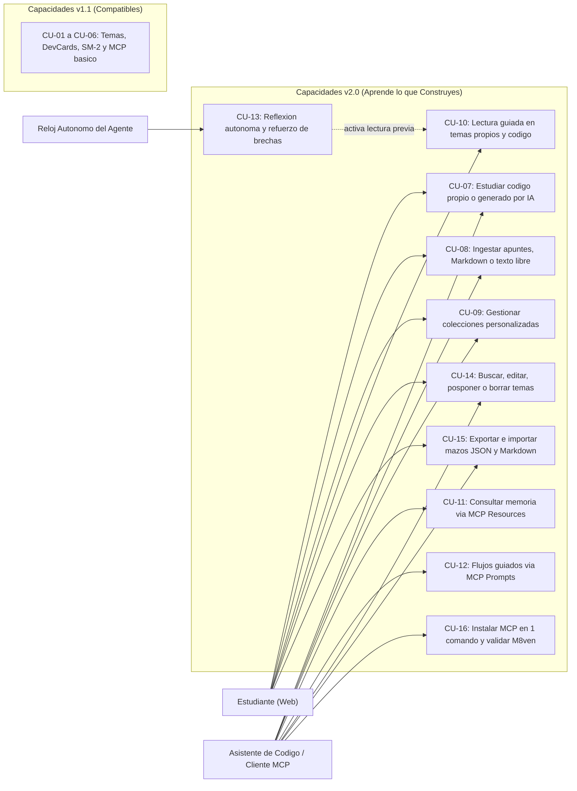
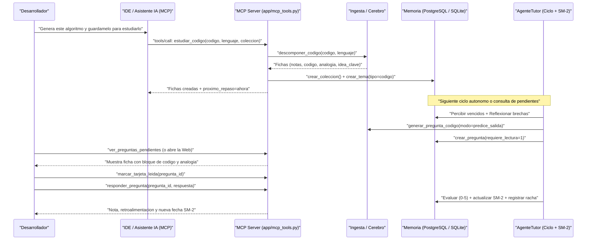

# Casos de Uso v2.0 — Agente Tutor Persistente & MCP Universal

Este documento amplía la especificación original de [CASOS_DE_USO.md](CASOS_DE_USO.md) (`CU-01` a `CU-06`, los cuales se conservan intactos por compatibilidad) incorporando los **10 nuevos casos de uso (`CU-07` a `CU-16`)** para la versión **v2.0: Aprende lo que Construyes**.

---

## 1. Actores del sistema (v2.0)

| Actor | Tipo | Descripción |
|---|---|---|
| **Estudiante** | Humano | Persona que usa la interfaz web (`/`) para enviar código, ingestar apuntes, organizar colecciones, leer fichas, responder preguntas y revisar su racha y brechas. |
| **Asistente de Código / Cliente MCP** | Agente / IDE | Claude Code, Cursor, Antigravity, Codex o Claude Desktop conectado por Streamable HTTP (`/mcp`) o `stdio` (`agente-tutor-mcp` / `python -m app.mcp_tools`) usando Tools, Resources y Prompts. |
| **Reloj del Agente** | Sistema autónomo | Hilo en segundo plano (`AgenteTutor._bucle`, respaldado en Render por `.github/workflows/despertador.yml`) que ejecuta `percibir → reflexionar → decidir → actuar`. |

---

## 2. Diagrama de Casos de Uso (v2.0)

---

## 3. Especificación detallada de Casos de Uso (`CU-07` a `CU-16`)

### CU-07: Capturar y estudiar código generado por IA o escrito por el usuario
- **Actor principal**: Asistente de Código / Cliente MCP (`estudiar_codigo`) o Estudiante (`POST /api/estudiar/codigo`).
- **Precondiciones**: Servidor activo; si `TUTOR_TOKEN` está definido, el cliente envía cabecera válida. El código tiene entre `10` y `12 000` caracteres.
- **Flujo principal**:
  1. Tras generar una función, endpoint, query SQL o clase (o pegar código propio), el cliente invoca `estudiar_codigo(codigo, lenguaje, titulo, coleccion, objetivo)`.
  2. El módulo `app/ingesta.py` y `Cerebro` (Gemini si hay clave; parser determinista local si no) descomponen el fragmento en 1 a 5 fichas atómicas con: `nombre`, `notas` (explicación), `codigo`, `lenguaje`, `analogia`, `idea_clave` y `tipo="codigo"`.
  3. Cada ficha se asocia a la colección indicada (creándola si no existe) con `proximo_repaso=ahora()`.
  4. En el siguiente ciclo (o al consultar pendientes), `AgenteTutor` prepara una pregunta rotando modalidad (`explica_codigo`, `predice_salida`, `detecta_bug`, `concepto`) y activa `requiere_lectura=1` para el primer contacto.
  5. Se anota en `bitacora` (tipo `sistema`) cuántas fichas de código se registraron.
- **Flujos alternos**:
  - **Sin `GEMINI_API_KEY` o sin red**: El parser local extrae símbolos (`def`, `class`, `function`, `SELECT`, etc.), arma el resumen y genera preguntas deterministas de traza o completado.
  - **422 Unprocessable Entity**: Código vacío o superior a `12 000` caracteres.
- **Postcondición**: El código queda guardado como fichas persistentes que el estudiante repasará de forma espaciada en Web o MCP.

---

### CU-08: Ingestar apuntes, textos o documentación libre para generar fichas estructuradas
- **Actor principal**: Estudiante (`POST /api/estudiar/material`) o Cliente MCP (`ingestar_material`).
- **Precondiciones**: Texto o Markdown entre `20` y `25 000` caracteres; token válido si aplica.
- **Flujo principal**:
  1. El usuario pega apuntes de clase, un artículo técnico, vocabulario o un archivo Markdown indicando una colección destino (ej. *"Arquitectura Cloud"*) y un límite máximo de fichas (`max_fichas`, por defecto `5`, máximo `15`).
  2. `ingestar_material()` segmenta por encabezados (`#`, `##`, `###`), listas o párrafos semánticos; si Gemini está disponible sintetiza definiciones, analogías e ideas clave; en modo local extrae la idea principal y palabras clave por sección.
  3. Inserta las fichas en `temas` (`tipo="material"`, `coleccion_id`) evitando duplicar títulos ya presentes en la misma colección.
  4. Devuelve el listado de fichas creadas y la colección resultante.
- **Flujos alternos**:
  - **Título duplicado en la colección**: Se omite la ficha duplicada e informa cuántas fueron omitidas sin abortar el lote completo.
- **Postcondición**: Cualquier disciplina o material queda convertido en tarjetas de estudio programadas con SM-2.

---

### CU-09: Crear, organizar, activar o pausar colecciones personalizadas
- **Actor principal**: Estudiante (Web) o Cliente MCP (`gestionar_coleccion`).
- **Precondiciones**: Servidor activo y autorización válida para operaciones de escritura.
- **Flujo principal**:
  1. El actor solicita `crear`, `listar`, `activar`, `pausar`, `renombrar` o `eliminar` una colección (`nombre`, `descripcion`, `icono/color`).
  2. `Memoria` persiste el cambio en la tabla `colecciones`.
  3. Cuando una colección está pausada (`activa=0`), `AgenteTutor.ciclo()` omite temporalmente sus temas aunque estén vencidos, priorizando solo colecciones activas.
- **Flujos alternos**:
  - **409 Conflict**: Ya existe una colección con el mismo nombre (insensible a mayúsculas).
  - **404 Not Found**: La colección referenciada no existe.
- **Postcondición**: El estudiante controla qué áreas de estudio están activas en cada semana sin borrar su historial.

---

### CU-10: Leer ficha enriquecida antes de responder en temas propios y de código
- **Actor principal**: Estudiante (Web) o Cliente MCP (`ver_preguntas_pendientes` + `marcar_tarjeta_leida`).
- **Precondiciones**: Existe una pregunta pendiente con `requiere_lectura=true` cuyo tema es de tipo `codigo`, `material` o `nota` enriquecida (o `devcard`).
- **Flujo principal**:
  1. `AgenteTutor.lectura_de(p)` detecta que el tema tiene campos enriquecidos (`codigo`, `notas`, `analogia`, `idea_clave`) y construye el objeto `lectura` unificado aunque no provenga de `devcards.json`.
  2. La Web o el Cliente MCP muestra primero la ficha completa (incluyendo el bloque `<pre><code>` formateado si es código) sin revelar la pregunta ni la respuesta esperada.
  3. El usuario confirma lectura (`POST /api/preguntas/{id}/leida` o `marcar_tarjeta_leida`).
  4. El sistema desbloquea la pregunta para responder y registra el evento en `bitacora`.
- **Flujos alternos**:
  - Si `TUTOR_LEER_ANTES=0`, se pasa directo a la pregunta.
  - Si intenta responder antes de marcar lectura, responde `409 Conflict`.
- **Postcondición**: El primer contacto con cualquier código o apunte nuevo garantiza comprensión antes de evaluar.

---

### CU-11: Consultar memoria viva vía MCP Resources
- **Actor principal**: Cliente MCP (Claude Code, Cursor, Antigravity, Claude Desktop).
- **Precondiciones**: Conexión MCP activa (`/mcp` o `stdio`).
- **Flujo principal**:
  1. El cliente o modelo lee uno de los 6 recursos sin ejecutar acciones de escritura:
     - `tutor://estado` (estado técnico, racha y configuración)
     - `tutor://pendientes` (cola actual sin `respuesta_esperada`)
     - `tutor://colecciones` (colecciones activas/pausadas y conteos)
     - `tutor://tema/{tema_id}` (ficha completa y métricas SM-2)
     - `tutor://brechas` (temas difíciles en refuerzo)
     - `tutor://bitacora/reciente` (últimas decisiones y reflexiones)
  2. El servidor MCP serializa el JSON vivo directamente desde `AgenteTutor` y `Memoria`.
- **Flujos alternos**:
  - `tutor://tema/{tema_id}` inexistente devuelve error controlado de recurso no encontrado.
- **Postcondición**: El asistente externo tiene contexto inmediato del aprendizaje del usuario sin consumir llamadas innecesarias a herramientas de escritura.

---

### CU-12: Ejecutar flujos pedagógicos guiados vía MCP Prompts
- **Actor principal**: Cliente MCP / Usuario dentro de su asistente de IA.
- **Precondiciones**: Cliente MCP con soporte de Prompts (`prompts/list`, `prompts/get`).
- **Flujo principal**:
  1. El usuario selecciona un prompt en su IDE/chat:
     - `sesion_repaso(coleccion?)`: guía una sesión interactiva pregunta a pregunta sin revelar respuestas.
     - `aprender_codigo_generado(lenguaje?)`: instruye al asistente a explicar brevemente el último código que escribió y llamar a `estudiar_codigo`.
     - `ingestar_apuntes(coleccion)`: guía al asistente a estructurar notas largas del chat y enviarlas a `ingestar_material`.
     - `tutor_socratico(tema)`: usa preguntas guía antes de evaluar con `responder_pregunta`.
     - `resumen_semanal()`: combina `tutor://estado`, `tutor://brechas` y `ver_progreso` para emitir un plan de estudio.
  2. El servidor devuelve las instrucciones estructuradas con contexto actual.
- **Postcondición**: Estandariza cómo cualquier IA externa colabora con el tutor persistente.

---

### CU-13: Reflexión autónoma y refuerzo de brechas persistentes en el ciclo del agente
- **Actor principal**: Reloj del agente (`AgenteTutor.ciclo()`).
- **Precondiciones**: Existen temas con historial de respuestas en `temas` y `respuestas`.
- **Flujo principal**:
  1. Tras **Percibir**, el agente ejecuta **Reflexionar**: identifica temas con `fallos >= 3` o `facilidad <= 1.6` que aún no estén marcados `en_refuerzo=1`.
  2. Marca `en_refuerzo=1`, anota en `bitacora` (tipo `reflexion`): *«Detecté brecha persistente en «Tema» (N fallos, facilidad X). Activo lectura guiada y cambio de ángulo.»*.
  3. Cuando ese tema vence, `_preparar_pregunta()` activa `requiere_lectura=1` nuevamente y pasa `fallos_recientes` a `Cerebro` para evitar repetir la misma pregunta fallada.
  4. Al lograr 2 aciertos seguidos (`nota >= 4`), el agente limpia `en_refuerzo=0`.
- **Flujos alternos**:
  - Si no hay brechas nuevas, la fase `reflexionar` continúa sin ruido en `bitacora`.
- **Postcondición**: El agente adapta su estrategia ante bloqueos reales del estudiante de forma autónoma y auditable.

---

### CU-14: Buscar, editar, posponer o eliminar temas de estudio
- **Actor principal**: Estudiante (Web) o Cliente MCP (`buscar_temas`, `editar_tema`, `borrar_tema`, `posponer_tema`).
- **Precondiciones**: Tema existente y token válido para operaciones de escritura.
- **Flujo principal**:
  1. El actor busca por palabra clave, colección o tipo (`GET /api/temas?q=&coleccion=&tipo=` o `buscar_temas`).
  2. Puede actualizar título, notas, código, analogía, idea clave o mover de colección (`PATCH /api/temas/{id}` o `editar_tema`), posponer el `proximo_repaso` N días (`POST /api/temas/{id}/posponer` o `posponer_tema`), o borrar definitivamente el tema en cascada (`DELETE /api/temas/{id}` o `borrar_tema`).
- **Flujos alternos**:
  - **404 Not Found**: El `tema_id` no existe.
- **Postcondición**: Control total del usuario sobre su base de conocimiento personal.

---

### CU-15: Importar y exportar mazos de estudio en JSON y Markdown
- **Actor principal**: Estudiante (Web) o Cliente MCP (`exportar_mazo`, `importar_mazo`).
- **Precondiciones**: Colección existente para exportar o payload JSON/Markdown válido para importar.
- **Flujo principal**:
  1. Al exportar (`GET /api/colecciones/{id}/exportar?formato=json|md` o `exportar_mazo`), el sistema genera un paquete portable con la colección y todas sus fichas (sin exponer credenciales).
  2. Al importar (`POST /api/colecciones/importar` o `importar_mazo`), valida esquema y límites, crea o reutiliza la colección e inserta las fichas nuevas omitiendo duplicados.
- **Flujos alternos**:
  - Formato no soportado o JSON malformado responde `422`.
- **Postcondición**: Cumple portabilidad de datos y permite compartir mazos entre estudiantes o respaldos locales.

---

### CU-16: Instalar el servidor MCP localmente en 1 comando y validar salud M8ven
- **Actor principal**: Desarrollador / Cliente MCP.
- **Precondiciones**: Python 3.12+ instalado; paquete configurado en `pyproject.toml`.
- **Flujo principal**:
  1. El usuario instala el paquete (`pip install -e .` o `uvx`) y ejecuta `agente-tutor-mcp`.
  2. El binario arranca el transporte `stdio` conectándose a `DATABASE_URL` y exponiendo las 19 Tools (todas con 4 `ToolAnnotations` booleanos), 6 Resources y 5 Prompts.
  3. El cliente o suite `tests/test_mcp_v2.py` verifica que el 100% de herramientas respondan con esquemas y hints válidos.
- **Postcondición**: Adopción inmediata en cualquier cliente MCP manteniendo máxima confianza en M8ven Trust Index.

---

## 4. Diagrama de secuencia — Flujo estrella "Aprende lo que Construyes"

