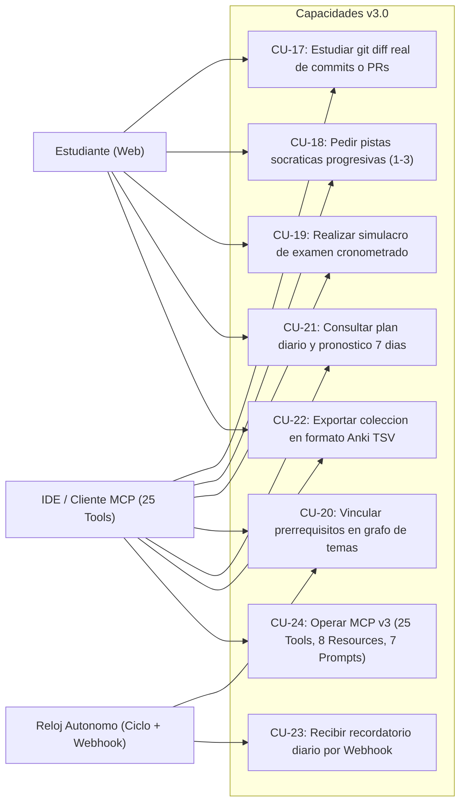
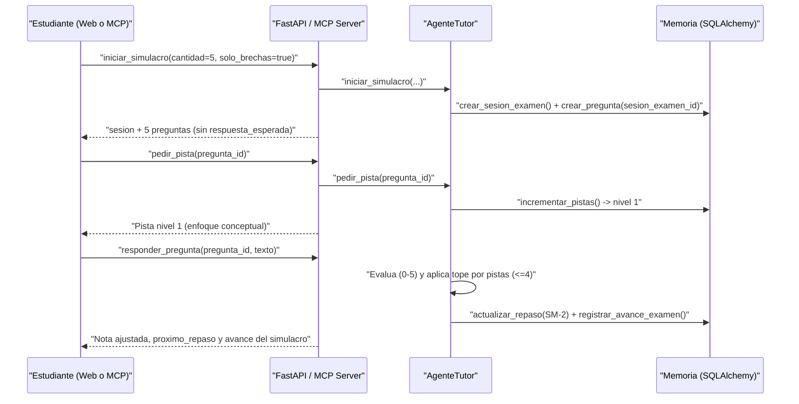

# Casos de Uso v3.0 — Tutor Adaptativo & Ecosistema MCP Profesional

Este documento amplía [CASOS_DE_USO.md](CASOS_DE_USO.md) (`CU-01`–`CU-06`) y [CASOS_DE_USO_V2.md](CASOS_DE_USO_V2.md) (`CU-07`–`CU-16`) con los **8 nuevos casos de uso (`CU-17` a `CU-24`)** de la versión **3.0.0**.

---

## 1. Diagrama de Casos de Uso (v3.0)

---

## 2. Especificación detallada (`CU-17` a `CU-24`)

### CU-17: Estudiar un `git diff` real de cambios recientes
- **Actor principal**: Desarrollador / Cliente MCP (`estudiar_diff`) o Estudiante (`POST /api/estudiar/diff`).
- **Precondiciones**: `diff_texto` entre `15` y `30 000` caracteres; token válido si `TUTOR_TOKEN` está definido.
- **Flujo principal**:
  1. El actor envía el resultado de `git diff` con título y colección opcional.
  2. `parsear_git_diff_local()` o `Cerebro.descomponer_diff()` agrupa los bloques por archivo (`+++ b/...`), detecta lenguaje por extensión y resume líneas añadidas/eliminadas.
  3. Persiste fichas `tipo="codigo"` etiquetadas con `diff` y las programa con SM-2 y lectura guiada previa.
- **Flujos alternos**:
  - `diff_texto` demasiado corto/largo devuelve `422`.
  - Si un bloque ya existe en la colección, se omite sin fallar.
- **Postcondición**: Los cambios reales del código quedan convertidos en fichas de repaso.

---

### CU-18: Solicitar pistas socráticas progresivas (Niveles 1–3)
- **Actor principal**: Estudiante (`POST /api/preguntas/{id}/pista`) o Cliente MCP (`pedir_pista`).
- **Precondiciones**: Pregunta pendiente (`estado="pendiente"`).
- **Flujo principal**:
  1. El actor solicita una pista.
  2. `Memoria.incrementar_pistas()` sube `pistas_usadas` (`1`, `2`, `3`).
  3. `generar_pista_progresiva()` entrega: Nivel 1 (enfoque/analogía), Nivel 2 (idea clave) o Nivel 3 (inicial y conteo de palabras sin revelar la respuesta completa).
  4. Al responder posteriormente, `AgenteTutor.responder()` aplica un tope justo a la nota SM-2 (`1` pista -> máx `4`, `>=2` pistas -> máx `3`).
- **Flujos alternos**:
  - Al pedir más de 3 pistas, devuelve el nivel 3 indicando `pistas_restantes: 0`.
  - Pregunta ya respondida devuelve `409`; inexistente devuelve `404`.
- **Postcondición**: El estudiante supera bloqueos aprendiendo activamente sin falsear el intervalo SM-2.

---

### CU-19: Ejecutar un simulacro de examen cronometrado
- **Actor principal**: Estudiante (`POST /api/examenes`) o Cliente MCP (`iniciar_simulacro`, `ver_simulacros`).
- **Precondiciones**: Existen temas o categorías DevCards disponibles.
- **Flujo principal**:
  1. El actor inicia un simulacro indicando `titulo`, `cantidad` (`1–20`) y filtro opcional (`coleccion_id`, `categoria_devcards` o `solo_brechas=true`).
  2. `AgenteTutor.iniciar_simulacro()` crea una sesión en `sesiones_examen` y genera las preguntas del examen con `requiere_lectura=False` (sin exponer `respuesta_esperada`).
  3. Cada respuesta enviada con `responder` actualiza automáticamente `respondidas`, `correctas`, `nota_promedio`, temas fallados y cierra la sesión al completar el total.
- **Flujos alternos**:
  - Sin temas candidatos disponibles responde `422`.
- **Postcondición**: El estudiante obtiene un reporte cuantitativo persistente y cada respuesta también alimenta su SM-2.

---

### CU-20: Vincular temas en grafo de prerrequisitos
- **Actor principal**: Estudiante / Cliente MCP (`vincular_temas`, `POST /api/temas/relaciones`) y Reloj Autónomo (`ciclo()`).
- **Precondiciones**: Ambos temas (`origen_id`, `destino_id`) existen en `temas`.
- **Flujo principal**:
  1. El actor vincula `tema A` como `prerrequisito` de `tema B` (o `relacionado`).
  2. Cuando `AgenteTutor.ciclo()` percibe que ambos están vencidos y `A` aún no supera su primer día (`intervalo_dias < 1` o `en_refuerzo`), eleva la prioridad de `A` (`+50`) y deja constancia en el `motivo`.
- **Flujos alternos**:
  - Mismo ID (`origen_id == destino_id`) o ciclo inverso directo (`B -> A` ya existente) responde `422` / `ValueError`.
- **Postcondición**: El orden de estudio respeta dependencias pedagógicas reales.

---

### CU-21: Consultar plan de estudio diario y pronóstico de 7 días
- **Actor principal**: Estudiante (`GET /api/plan`) o Cliente MCP (`plan_estudio_hoy`, `tutor://plan/hoy`).
- **Precondiciones**: Servidor inicializado.
- **Flujo principal**:
  1. El actor solicita el plan del día.
  2. `AgenteTutor.plan_estudio_hoy()` calcula respuestas de hoy vs `TUTOR_META_DIARIA`, porcentaje de cumplimiento, carga pendiente/vencida, tiempo estimado en minutos, racha actual y distribución de temas que vencen en cada uno de los próximos 7 días.
- **Postcondición**: Visibilidad clara de la carga de estudio semanal.

---

### CU-22: Exportar colecciones en formato Anki TSV (`.tsv`)
- **Actor principal**: Estudiante (`GET /api/colecciones/{id}/exportar?formato=anki`) o Cliente MCP (`exportar_mazo`).
- **Precondiciones**: Colección existente.
- **Flujo principal**:
  1. Solicita exportación con `formato="anki"`.
  2. El sistema genera líneas TSV (`Frente\tReverso\tEtiquetas`) escapando saltos de línea como ` ` y tabulaciones como espacios.
- **Postcondición**: Archivo compatible con importación directa en Anki Desktop / AnkiWeb.

---

### CU-23: Recibir recordatorio diario proactivo vía Webhook
- **Actor principal**: Reloj Autónomo (`AgenteTutor.ciclo()`).
- **Precondiciones**: `TUTOR_WEBHOOK_URL` configurado en variables de entorno con `http://` o `https://`, existen preguntas pendientes o temas vencidos, y `latido.ultima_notificacion != fecha_hoy_utc`.
- **Flujo principal**:
  1. Al finalizar `ciclo()`, `_notificar_si_corresponde()` verifica la condición y envía un POST JSON con resumen (`pendientes`, `vencidos`, `racha_dias`, `recomendacion`).
  2. Actualiza `latido.ultima_notificacion = fecha_hoy_utc` y anota en `bitacora`.
- **Flujos alternos**:
  - Si el webhook falla o hay timeout, registra advertencia sin detener el ciclo autónomo.
- **Postcondición**: Como máximo una notificación al día, sin spam y sin riesgo SSRF.

---

### CU-24: Operar ecosistema MCP v3 (25 Tools, 8 Resources, 7 Prompts)
- **Actor principal**: Asistente de IA / IDE externo (Claude Code, Cursor, Antigravity, Codex, Claude Desktop).
- **Precondiciones**: Cliente conectado por `stdio` o `/mcp`.
- **Flujo principal**:
  1. El cliente descubre las 25 Tools (todas con las 4 `ToolAnnotations` booleanas), los 8 Resources (`tutor://*`) y los 7 Prompts (`estudiar_ultimo_diff`, `entrevista_tecnica`, etc.).
  2. Ejecuta flujos completos de revisión de diffs, simulacros de entrevista técnica y consultas de plan diario directamente desde el IDE.
- **Postcondición**: Interoperabilidad total sincronizada con la Web y la base de datos persistente.

---

## 3. Diagrama de secuencia — Pistas Socráticas + Simulacro + Grafo

