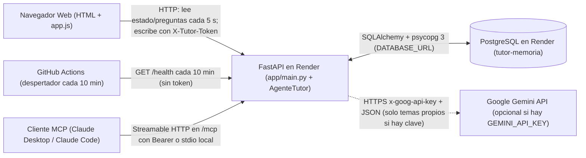

# Cómo funciona el Agente Tutor Persistente

Guía en español simple pensada para entender el programa por dentro y explicarlo con seguridad en una exposición en clase.

---

## 1. Qué hace el programa en 5 líneas

1. Es un tutor de estudio web que **recuerda todo** en una base de datos real (PostgreSQL en Render o SQLite en local), incluso si el servidor se reinicia.
2. Tiene un **reloj autónomo** en segundo plano que despierta cada pocos segundos (`20 s` en Render, `30 s` por defecto) para revisar qué temas vencieron.
3. Si activas mazos del banco integrado de **1 295 tarjetas DevCards** (42 categorías), te muestra primero su ficha completa para leerla antes de hacerte la pregunta.
4. Cuando respondes en la web (o desde Claude por **MCP**), califica tu respuesta de `0` a `5` usando Gemini (si hay clave) o su motor determinista local.
5. Con esa nota, el algoritmo **SM-2** calcula cuándo volverás a olvidar ese concepto y programa automáticamente la fecha de tu próximo repaso.

---

## 2. El recorrido de una pregunta de principio a fin

Así viaja una pregunta desde que se enciende el servidor hasta que se reprograma tu próximo repaso:

1. **El servidor enciende al agente** (`app/main.py` -> `lifespan()` -> `app/agente.py` -> `AgenteTutor.iniciar()` y `despertar()`):
   - Al arrancar FastAPI, se crea una instancia de `AgenteTutor` con la configuración de `app/config.py` (`Config.desde_entorno()`).
   - `despertar()` llama a `Memoria.registrar_arranque()` en `app/memoria.py` para sumar `+1` al contador `arranques` de la tabla `latido`, mira cuántos temas y preguntas había guardados, escribe en la tabla `bitacora` *«Desperté por N.ª vez...»* y lanza el hilo en segundo plano (`_bucle`).
2. **El agente despierta solo cada X segundos** (`app/agente.py` -> `AgenteTutor._bucle()` -> `AgenteTutor.ciclo()`):
   - **Percibir**: consulta `Memoria.pendientes()`, `Memoria.listar_temas()` y busca cuáles tienen `proximo_repaso <= ahora` sin pregunta pendiente (`vencidos`), respetando el tope `TUTOR_MAX_PENDIENTES` (por defecto `3`).
   - **Decidir**: ordena primero los repasos vencidos con `prioridad(x)` (días de atraso + baja facilidad + fallos). Si todavía sobra cupo y hay algún mazo activo (`Memoria.mazos_activos()`), pide a `BancoDevCards.siguiente()` (`app/banco_devcards.py`) la tarjeta no vista más fácil y la guarda como tema nuevo sin pasarse de `TUTOR_NUEVAS_POR_DIA` (`5`).
3. **Crea la pregunta pendiente** (`app/agente.py` -> `_preparar_pregunta()` -> `app/memoria.py` -> `Memoria.crear_pregunta()`):
   - Anota el motivo exacto de su decisión en la tabla `bitacora`.
   - Si es tema propio, llama a `Cerebro.generar_pregunta()` (`app/cerebro.py`: intenta con Google Gemini; si no hay `GEMINI_API_KEY` o falla la red, arma un completado local con `_____`).
   - Si es DevCard, llama a `BancoDevCards.pregunta_de()` (`variante` par -> opción múltiple; impar -> pregunta abierta). Si `vista_antes == 0` y `TUTOR_LEER_ANTES=1`, guarda `requiere_lectura = 1`.
4. **La página web la muestra en modo lectura** (`app/static/app.js` -> `cargarTodo()` -> `GET /api/preguntas/pendientes` -> `rellenarTarjetaLectura()`):
   - Cada `5` segundos el navegador pregunta `GET /api/preguntas/pendientes` (`pendientes()` en `app/main.py`).
   - Si `requiere_lectura` es `true`, `app.js` dibuja **solo la lectura** (`AgenteTutor.lectura_de()`: título, categoría, dificultad, definición, *«Piénsalo así»*, código en `<pre><code>` e *«Idea clave»*) junto al botón **«Ya la leí, hazme la pregunta»**.
5. **Confirmas que ya la leíste** (`app/static/app.js` -> `marcarTarjetaLeida()` -> `POST /api/preguntas/{id}/leida` -> `AgenteTutor.marcar_leida()` -> `Memoria.marcar_leida()`):
   - Al pulsar el botón, se guarda la hora actual en `preguntas.leida_en`, `requiere_lectura` pasa a `false` y la **misma** tarjeta cambia al instante a modo pregunta colocando el foco en el enunciado.
6. **Respondes y se corrige** (`app/static/app.js` -> `enviarRespuesta()` -> `POST /api/preguntas/{id}/responder` -> `AgenteTutor.responder()`):
   - Si intentaras responder antes de marcar la lectura, `responder()` rechaza con `409 ("Primero lee la tarjeta")`.
   - Si es opción múltiple (`A-H`), `_corregir_opcion_multiple()` da nota `5` si aciertas o `1` si fallas. Si es pregunta abierta, `Cerebro.evaluar()` califica de `0` a `5` con Gemini o comparación local de conceptos clave.
   - `Memoria.registrar_respuesta()` marca la pregunta como `"respondida"` y guarda tu respuesta en la tabla `respuestas`.
7. **SM-2 reprograma el próximo repaso** (`app/agente.py` -> `responder()` -> `app/sm2.py` -> `actualizar()` -> `Memoria.actualizar_repaso()`):
   - Con tu nota (`0–5`), `sm2.actualizar()` recalcula `repeticiones`, `facilidad` (entre `1.3` y `2.5+`) e `intervalo_dias` (`1` día si fallas o 1.er acierto; `6` días en 2.º acierto; luego `intervalo * facilidad`).
   - Calcula `proximo_repaso = ahora + intervalo_dias * TUTOR_MINUTOS_POR_DIA` minutos y lo guarda en la tabla `temas`. Al cumplirse ese tiempo, `ciclo()` lo volverá a detectar como vencido —esta vez directo con pregunta, sin repetir la lectura previa—.

---

## 3. Dónde veo cómo trabaja

Durante una demostración o mientras estudias, puedes inspeccionar lo que hace el agente en 6 lugares reales:

- **Bitácora de la página web** (sección inferior en `/` que lee `GET /api/bitacora`): muestra en orden del más reciente al más antiguo cada evento (`sistema`, `ciclo`, `decision`, `pregunta`, `evaluacion`, `error`) con su hora exacta.
- **`GET /api/estado`**: devuelve el JSON completo con `vivo`, `proceso_activo_hace_s`, `latido` (`arranques`, `ciclos`, `ultimo_ciclo`), `cerebro`, `base_de_datos`, `mazos_activos`, `pendientes`, `configuracion` y `progreso`.
- **`GET /health`**: endpoint liviano que responde `{"ok": true, "agente_vivo": true, "ciclos": ..., "arranques": ..., "ultimo_ciclo": ...}`; sirve tanto para Render como para confirmar con un vistazo que sigue vivo.
- **`/docs` (Swagger UI de FastAPI)**: documentación interactiva generada automáticamente por FastAPI donde se ven todos los endpoints y sus modelos de datos, con opción de probar peticiones desde el navegador.
- **Logs en el panel de Render**: en Render entra al servicio `agente-tutor-persistente` y abre la pestaña **Logs** para ver los registros de Python (`logging.INFO`), peticiones HTTP recibidas (incluido cada `/health` del despertador) y cualquier aviso si Gemini no estuvo disponible.
- **Base de datos PostgreSQL / SQLite (`app/memoria.py`)**: toda la información real reside en 6 tablas (`temas`, `preguntas`, `respuestas`, `mazos`, `bitacora` y `latido`), inspeccionables en local o desde Render (`tutor-memoria`).

---

## 4. Cómo es la conexión

### Qué viaja por cada conexión y qué protege `TUTOR_TOKEN`

- **Navegador ↔ FastAPI en Render**:
  - Por las rutas **GET** (`/`, `/privacidad`, `/health`, `/api/estado`, `/api/preguntas/pendientes`, `/api/temas`, `/api/mazos`, `/api/progreso`, `/api/historial`, `/api/bitacora`) viaja solo JSON de lectura o archivos estáticos, **sin contraseña**.
  - Por las rutas que modifican datos (**`POST /api/temas`**, **`DELETE /api/temas/{id}`**, **`POST /api/preguntas/{id}/leida`**, **`POST /api/preguntas/{id}/responder`**, **`PUT /api/mazos/{categoria}`**, **`POST /api/ciclo`**, más **`GET /api/acceso`** para validar clave) viaja el JSON de tu acción y la cabecera **`X-Tutor-Token`** (o `Authorization: Bearer`). Si `TUTOR_TOKEN` está definido en el servidor y no coincide (`hmac.compare_digest`), `exigir_token` responde **`401`** antes de ejecutar nada.
- **FastAPI ↔ PostgreSQL (`tutor-memoria`)**:
  - Viajan consultas SQL vía `DATABASE_URL` (`postgresql+psycopg://`) con los 6 cuadros de memoria (`temas`, `preguntas`, `respuestas`, `mazos`, `bitacora`, `latido`). Así sobrevive a reinicios.
- **GitHub Actions (`despertador.yml`) → `/health`**:
  - Cada 10 minutos (`*/10 * * * *`) ejecuta `curl` a `$TUTOR_URL/health` para que Render no suspenda el servicio gratuito por 15 min de inactividad. No lleva token porque `/health` solo consulta lectura ligera.
- **Cliente MCP ↔ `/mcp` (o `stdio`)**:
  - Si conectas remoto por Streamable HTTP a `https://<tu-servicio>.onrender.com/mcp`, el middleware `proteger_mcp` exige **`Authorization: Bearer <TUTOR_TOKEN>`** (o `X-Tutor-Token`). Por dentro llama a las mismas funciones de `AgenteTutor` (`app/mcp_tools.py`).
- **Agente ↔ Google Gemini API**:
  - Solo ocurre si `GEMINI_API_KEY` tiene una clave configurada y hay que redactar o corregir algo abierto: crear la pregunta de un **tema propio**, o calificar una respuesta abierta (de un tema propio o de la pregunta abierta de una DevCard, que se alterna con su quiz). Las preguntas de opción múltiple de las DevCards nunca usan Gemini: se corrigen localmente. Viaja por HTTPS con cabecera `x-goog-api-key` y JSON (nombre del tema, notas, pregunta, respuesta esperada y tu respuesta; sin contraseñas de usuario). Si no hay clave o falla Internet, `app/cerebro.py` usa el motor local y no sale nada del servidor.

---

## 5. Mapa de archivos del proyecto

| Ruta | Qué contiene y para qué sirve |
|---|---|
| `app/config.py` | Lee todas las variables de entorno (`DATABASE_URL`, `GEMINI_API_KEY`, `TUTOR_TOKEN`, tiempos SM-2, `TUTOR_LEER_ANTES`) en la clase `Config`. |
| `app/sm2.py` | Función pura del algoritmo SuperMemo 2 (`EstadoSM2`, `actualizar`) que calcula nuevo intervalo y facilidad según nota `0–5`. |
| `app/memoria.py` | Tablas SQLAlchemy (`temas`, `preguntas`, `respuestas`, `mazos`, `bitacora`, `latido`), migración segura (`_migrar`) y operaciones con PostgreSQL/SQLite. |
| `app/cerebro.py` | Motor cognitivo (`Cerebro`): llama a Gemini API si hay clave y usa reglas locales deterministas como respaldo en temas abiertos. |
| `app/banco_devcards.py` | Carga `app/data/devcards.json` (`1 295` tarjetas), lista las `42` categorías y elige la siguiente tarjeta nueva según dificultad (`siguiente`). |
| `app/data/devcards.json` | Banco de conocimiento estático de solo lectura con 1 295 DevCards (licencia MIT). |
| `app/agente.py` | Clase `AgenteTutor`: ciclo autónomo `percibir -> decidir -> actuar`, manejo de lectura previa, evaluación y métricas de estado/progreso. |
| `app/mcp_tools.py` | Servidor MCP con 9 herramientas conectadas a `AgenteTutor` (para `/mcp` remoto o `python -m app.mcp_tools` en local). |
| `app/main.py` | Servidor FastAPI: rutas REST, seguridad con `TUTOR_TOKEN`, páginas web, `lifespan` del agente y montaje de `/mcp`. |
| `app/static/index.html` | Estructura semántica HTML de una sola página con las secciones Estudiar, Progreso, Mis temas, Mazos, Bitácora y diálogo de clave. |
| `app/static/estilos.css` | Estilos editoriales claros (WCAG 2.1 AA), botones mínimos de `44 px`, diseño móvil desde `360 px` y código con scroll horizontal propio. |
| `app/static/app.js` | Lógica del navegador: refresco cada 5 s sin perder foco, construcción DOM con `textContent`, transición lectura->pregunta y manejo de `401`. |
| `app/static/privacidad.html` | Página `/privacidad` que explica qué datos se guardan, cuándo se usa Gemini y cómo borrar temas. |
| `tests/test_nucleo.py` | Pruebas unitarias y de integración del núcleo (`sm2`, `memoria`, `cerebro`, `banco_devcards`, `agente`, modo lectura). |
| `tests/test_api.py` | Pruebas de endpoints REST, autenticación `TUTOR_TOKEN`, `/mcp` y protección de escritura. |
| `docs/CONTRATO_API.md` | Contrato oficial de rutas HTTP, JSON de respuestas, códigos de error y herramientas MCP. |
| `docs/CASOS_DE_USO.md` | Actores, 6 casos de uso (`CU-01` a `CU-06`) y diagramas Mermaid de uso y secuencia. |
| `docs/GUION_EXPOSICION.md` | Guion cronometrado de 5 minutos para presentar el proyecto en clase con demo en vivo. |
| `docs/GUIA_RENDER.md` | Tutorial paso a paso para principiantes sobre cómo publicar en Render y activar el despertador. |
| `docs/COMO_FUNCIONA.md` | Este documento explicativo de arquitectura, flujo de datos y preguntas frecuentes. |
| `render.yaml` | Blueprint de Render que crea automáticamente el servicio web gratuito + PostgreSQL `tutor-memoria`. |
| `.github/workflows/ci.yml` | Flujo automático de GitHub Actions que ejecuta `pytest -q` en cada `push` o `pull_request`. |
| `.github/workflows/despertador.yml` | Cron de GitHub Actions que visita `$TUTOR_URL/health` cada 10 minutos para mantener vivo el servicio en Render. |
| `Dockerfile` / `docker-compose.yml` | Contenedor Python 3.12 (`uvicorn` en puerto 8000) y entorno local con PostgreSQL 16 (puerto `8001` configurable con `TUTOR_PUERTO`). |
| `requirements.txt` / `requirements-dev.txt` | Dependencias de ejecución (`fastapi`, `uvicorn`, `SQLAlchemy`, `psycopg`, `httpx`, `mcp`, `pydantic`) y pruebas (`pytest`). |

---

## 6. Preguntas frecuentes para la exposición

- **¿Cómo sabe si leí la tarjeta?**
  Solo lo sabe cuando tú pulsas el botón **«Ya la leí, hazme la pregunta»** (que llama a `POST /api/preguntas/{id}/leida` y guarda la fecha en `leida_en`) y por las respuestas que envías después. No vigila tu cámara, ni el scroll, ni el tiempo en pantalla.

- **¿Qué pasa si Render se apaga, suspende o reinicia el servicio?**
  Nada se borra. Todo vive en PostgreSQL (`tutor-memoria`), no en variables de Python. Al volver a encenderse, `AgenteTutor.despertar()` suma `+1` a `arranques`, revisa cuántos temas y preguntas había pendientes y continúa exactamente donde iba.

- **¿Dónde se guarda todo?**
  En las 6 tablas (`temas`, `preguntas`, `respuestas`, `mazos`, `bitacora` y `latido`) de PostgreSQL cuando corre en Render o Docker Compose, o en un archivo SQLite (`tutor.db`) en desarrollo local. El JSON de las `1 295` DevCards (`devcards.json`) es solo de lectura y nunca se modifica.

- **¿Por qué usa el algoritmo SM-2?**
  Porque SuperMemo 2 es un algoritmo estándar, simple y probado (el mismo en que se basa Anki) que espacia más lo que ya dominas (`1` día → `6` días → `intervalo * facilidad`) y hace regresar rápido lo que fallas (`repeticiones = 0`, `1` día y menor facilidad), optimizando el tiempo de estudio.

- **¿Es Inteligencia Artificial o no?**
  Tiene **dos partes separadas**: la toma de decisiones autónoma del agente (cuándo despertar, qué tema priorizar, límites diarios, repetición espaciada SM-2 y corrección del quiz de las DevCards) es un **algoritmo propio determinista**, no una caja negra de LLM. La IA generativa (**Google Gemini**) entra de forma **opcional** (solo si configuras `GEMINI_API_KEY`) para redactar las preguntas de tus temas propios y calificar las respuestas abiertas (de tus temas o de las preguntas abiertas de las DevCards). Sin clave, todo eso lo hace el motor local.

- **¿Qué es MCP y para qué sirve aquí?**
  *Model Context Protocol* es un estándar abierto para conectar asistentes de IA externos (como Claude Desktop o Claude Code) con herramientas reales. Aquí permite estudiar, consultar la bitácora y responder tus repasos pendientes desde el chat de Claude compartiendo exactamente la misma base de datos que la web (`app/mcp_tools.py`).

- **¿Por qué se llama «persistente» y no es solo un chatbot?**
  Un chatbot normal espera a que tú escribas y olvida al cerrar sesión. Este sistema es persistente por cuatro motivos juntos: tiene un ciclo autónomo con reloj propio (`_bucle`), conserva su estado completo y contador de reinicios en PostgreSQL (`latido`), planifica a futuro con SM-2 (`proximo_repaso`), y registra un historial auditable de decisiones (`bitacora`).

- **¿Qué limitaciones reales tiene esta versión?**
  Con el plan gratuito de Render, si el servicio llegara a dormirse el primer arranque tarda alrededor de **50 segundos**, la base PostgreSQL `free` caduca a los **30 días** y la cuenta tiene un límite de **750 horas/mes** entre sus servicios web gratuitos. Además, está diseñado como tutor personal con una sola clave compartida (`TUTOR_TOKEN`), sin sistema de múltiples cuentas de usuario.

- **¿Cómo se agregaría un tema propio de clase o examen?**
  En la sección **«Mis temas»** de la web escribes el título y pegas tus apuntes o definiciones (o usas `POST /api/temas` / la herramienta MCP `agregar_tema`). Queda guardado en `temas` con `origen="usuario"` y `proximo_repaso=ahora()`, así que en el próximo ciclo (`<= 20 s` en Render) el agente te hará tu primera pregunta basada en esas notas.

- **¿Qué pasa si no respondo las preguntas que me prepara el agente?**
  No genera preguntas infinitas ni llena la pantalla: cuando alcanza el límite `TUTOR_MAX_PENDIENTES` (`3` preguntas esperando respuesta), el agente sigue ejecutando sus latidos y dejando constancia cada 20 ciclos sin novedad (*«Sigo vivo: 3 preguntas esperando respuesta...»*), y espera pacientemente a que respondas para liberar hueco.
