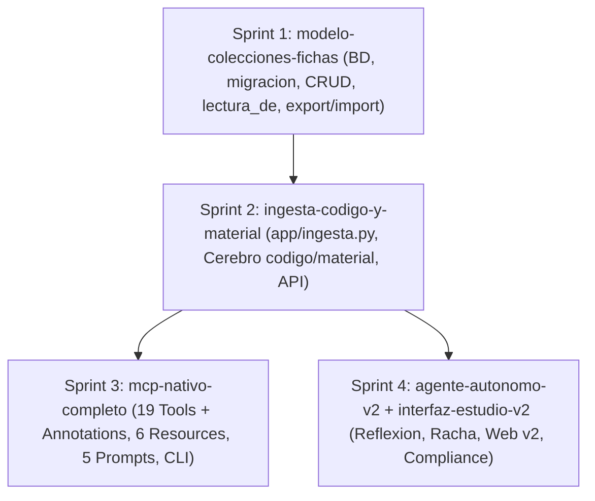

# Plan de Implementación v2.0 — Agente Tutor Persistente & MCP Universal

## 1. Resumen Ejecutivo

Este plan detalla la evolución incremental de **Agente Tutor Persistente** de la v1.1 hacia la **v2.0 («Aprende lo que Construyes»)** en **4 Sprints** ejecutables en rebanadas verticales verificables, manteniendo 100% de retrocompatibilidad con la API actual, el despliegue en Render (`PostgreSQL`), Docker Compose y el respaldo determinista local sin depender obligatoriamente de `GEMINI_API_KEY`.

---

## 2. Grafo de Dependencias de Módulos

---

## 3. Decisiones de Arquitectura Clave

1. **Migración aditiva sin pérdida de datos (`app/memoria.py::_migrar()`)**:
   - Las tablas nuevas (`colecciones`, `actividad_diaria`) se crean con `metadata.create_all(self.engine)`.
   - Los campos nuevos sobre `temas` (`tipo`, `coleccion_id`, `codigo`, `lenguaje`, `analogia`, `idea_clave`, `etiquetas`, `en_refuerzo`) se añaden mediante `_COLUMNAS_NUEVAS` con `ALTER TABLE` seguro compatible con **PostgreSQL** (Render) y **SQLite** (local/tests).
   - Se mantiene compatibilidad total con filas existentes creadas en v1.0/v1.1 (`tipo='nota'`, `en_refuerzo=0`, `coleccion_id=NULL`).
2. **Motor Dual Garantizado (`Cerebro` + `app/ingesta.py`)**:
   - Cada capacidad cognitiva nueva (`descomponer_codigo`, `ingestar_material`, `generar_pregunta_codigo`) intenta usar Google Gemini cuando existe `GEMINI_API_KEY`, y cae limpiamente a analizadores heurísticos/deterministas locales si no hay clave o falla la red.
3. **MCP Completo y Estándar M8ven Grado A (`app/mcp_tools.py`)**:
   - Se mantiene `mcp.server.mcpserver.MCPServer` (`mcp==2.3.0`).
   - Cada herramienta nueva y existente declarará explícitamente `ToolAnnotations` con los 4 booleanos (`read_only_hint`, `destructive_hint`, `idempotent_hint`, `open_world_hint`).
   - Se añaden 6 **Resources** (`@mcp.resource`) y 5 **Prompts** (`@mcp.prompt`), con `pyproject.toml` para instalar `agente-tutor-mcp`.
4. **Seguridad y Prevención de Vulnerabilidades**:
   - Sin descarga automática de URLs arbitrarias en v2.0 (evita SSRF); la ingesta opera sobre código, Markdown o texto enviado directamente.
   - Todo material enviado a Gemini se envuelve en delimitadores (`<codigo>`, `<material>`) con instrucción explícita anti-prompt-injection.
   - Validación estricta de longitudes en Pydantic y en las tools MCP, más `TUTOR_TOKEN` obligatorio en toda operación de escritura y en `/mcp`.
5. **UI Accesible sin dependencias de frontend externas (`app/static/`)**:
   - Se mantiene HTML semántico + CSS editorial (WCAG 2.1 AA, contraste >= `4.5:1`, botones >= `44px`) + JS vanilla seguro usando `textContent` / `createElement` (cero `innerHTML` con datos del usuario).

---

## 4. Hoja de Ruta en 4 Sprints

### Sprint 1 — Cimientos de Colecciones, Fichas Enriquecidas y CRUD Completo
- **Módulo**: `modelo-colecciones-fichas` (`T-01` a `T-06`)
- **Objetivo**: Dar soporte persistente a colecciones personalizadas, fichas ricas (`codigo`, `lenguaje`, `analogia`, `idea_clave`), lectura previa en temas de usuario, búsqueda/edición/posposición y exportación/importación JSON/Markdown.
- **Checkpoint Sprint 1**:
  - `pytest -v` pasa incluyendo pruebas de migración desde esquema v1 a v2.
  - Endpoints `/api/colecciones`, `/api/temas?q=`, `PATCH /api/temas/{id}`, `/posponer`, `/exportar`, `/importar` verificados.

### Sprint 2 — «Estudia lo que Construyes»: Ingesta de Código y Material Libre
- **Módulo**: `ingesta-codigo-y-material` (`T-07` a `T-12`)
- **Objetivo**: Permitir que cualquier fragmento de código o bloque de apuntes/Markdown se convierta en fichas atómicas listas para estudiar con preguntas inteligentes de traza, detección de fallos y explicación, con y sin Gemini.
- **Checkpoint Sprint 2**:
  - `tests/test_ingesta.py` pasa al 100% probando Python, JS/TS, SQL y Markdown tanto con Gemini simulado como en modo determinista local.
  - `POST /api/estudiar/codigo` y `POST /api/estudiar/material` operativos y protegidos con `TUTOR_TOKEN`.

### Sprint 3 — Servidor MCP Completo (Tools, Resources, Prompts y CLI)
- **Módulo**: `mcp-nativo-completo` (`T-13` a `T-18`)
- **Objetivo**: Elevar el proyecto a servidor MCP de referencia con 19 Tools anotadas, 6 Resources, 5 Prompts, paquete CLI instalable (`agente-tutor-mcp`), guías de conexión para los principales IDEs y cobertura 100% en pruebas.
- **Checkpoint Sprint 3**:
  - `tests/test_mcp_v2.py` valida las 19 Tools (con 4 hints booleanos), 6 Resources y 5 Prompts vía JSON-RPC y `MCPServer`.
  - Arranque local verificado con `agente-tutor-mcp` y remoto en `/mcp`.

### Sprint 4 — Agente Autónomo Reflexivo v2, Interfaz Web y Release v2.0
- **Módulos**: `agente-autonomo-v2` + `interfaz-estudio-v2` (`T-19` a `T-24`)
- **Objetivo**: Añadir fase `reflexionar` en `AgenteTutor.ciclo()` (detección de brechas y refuerzo guiado), racha diaria, interfaz web v2 completa (formularios de código/material, colecciones, brechas, búsqueda, exportar/importar), auditoría de las 20 reglas de compliance y actualización de Docker/docs.
- **Checkpoint Sprint 4 (Release v2.0)**:
  - Toda la suite (`pytest -v`) pasa al 100% sin `GEMINI_API_KEY`.
  - Auditoría de compliance (WCAG 2.1 AA, `/privacidad` con portabilidad y borrado, sin secretos) y `docker compose build` validados.

---

## 5. Riesgos y Mitigaciones

| Riesgo | Impacto | Mitigación |
|---|---|---|
| Fallo de `ALTER TABLE` en base PostgreSQL existente en Render | Alto | Usar `_migrar()` idempotente inspeccionando columnas existentes antes de alterar y probar en `tests/` simulando tabla v1 sin columnas nuevas. |
| Respuesta malformada de Gemini al descomponer código o Markdown | Medio | Validación estricta de esquema JSON en `Cerebro` y respaldo automático al parser determinista de `app/ingesta.py`. |
| Degradación de puntuación en M8ven Trust Index | Medio | Verificar automáticamente en `tests/test_mcp_v2.py` que toda tool nueva tenga los 4 `ToolAnnotations` booleanos y esté probada por nombre. |
| Sobrecarga visual en la interfaz Web | Medio | Mantener diseño editorial limpio por paneles/pestañas, formularios progresivos y cumplimiento estricto de `estilos.css` WCAG 2.1 AA. |
| Inyección de prompts en código o apuntes pegados | Alto | Delimitar entradas con `<codigo>` / `<material>`, limitar tamaño máximo de entrada y jamás ejecutar código ingresado por el usuario. |

---

## 6. Preguntas Abiertas

1. ¿Se mantiene en v2.0 el esquema de clave única compartida (`TUTOR_TOKEN`)?
2. ¿Se mantiene la ingesta segura basada únicamente en código/texto/Markdown enviado (sin descarga de URLs externas para prevenir SSRF)?
3. ¿Aprobamos iniciar Sprint 1 inmediatamente tras revisar este plan y el backlog?
