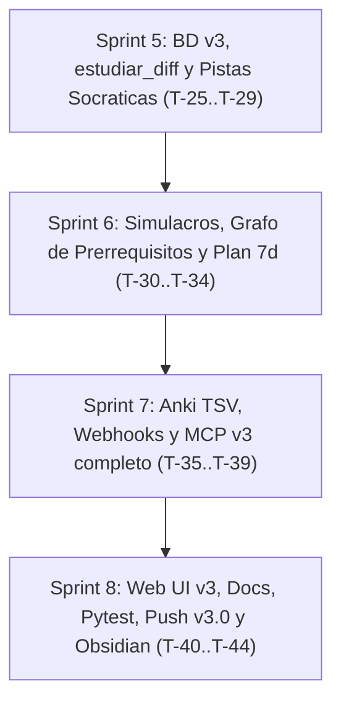

# Plan de Implementación v3.0 — Sprints 5 a 8

## 1. Visión de la Evolución v3.0

Tras completar y publicar la v2.0 (`colecciones`, `estudiar_codigo`, `ingestar_material`, MCP de 19 tools/6 resources/5 prompts y agente reflexivo), la **v3.0 («Tutor Adaptativo & Ecosistema MCP Profesional»)** añade 4 Sprints adicionales (**Sprints 5 a 8**, tareas `T-25` a `T-44`):

---

## 2. Decisiones Técnicas y Seguridad

1. **Migración aditiva compatible (`app/memoria.py::_migrar()`)**:
   - Nuevas tablas `relaciones_temas` y `sesiones_examen` vía `metadata.create_all()`.
   - Nuevas columnas `preguntas.pistas_usadas`, `preguntas.sesion_examen_id` y `latido.ultima_notificacion` vía `_COLUMNAS_NUEVAS`.
2. **Cero dependencias externas nuevas**:
   - Todo el parsing de `git diff`, pistas socráticas, cálculo del grafo de prerrequisitos, pronóstico de 7 días y formato Anki TSV se implementa en Python puro sobre el stack existente.
3. **Cero SSRF en Webhooks**:
   - `TUTOR_WEBHOOK_URL` se lee exclusivamente de `os.environ` (`app/config.py`), nunca de peticiones HTTP de usuarios. Se limita a máximo 1 envío por día UTC usando `latido.ultima_notificacion`.
4. **Calificación A en M8ven Trust Index**:
   - Las 25 herramientas MCP declararán explícitamente los 4 booleanos de `ToolAnnotations` y el 100% estará referenciado e invocado en `tests/`.

---

## 3. Riesgos y Mitigaciones

| Riesgo | Impacto | Mitigación |
|---|---|---|
| Ciclos en el grafo de prerrequisitos (`A -> B -> A`) | Medio | Validar en `vincular_temas()` rechazando `origen_id == destino_id` y ruta inversa directa antes de insertar. |
| Inflación artificial de intervalos SM-2 usando pistas | Medio | Tope automático en `AgenteTutor.responder()`: 1 pista -> nota máx `4`; >=2 pistas -> nota máx `3`. |
| Fallo de red al enviar Webhook diario | Bajo | Envío dentro de `try/except` con timeout de `5.0 s`; registra aviso en `bitacora` sin afectar el ciclo del agente. |
| Regresión de los 41 tests existentes v2.0 | Alto | Ejecutar `pytest -v` completo tras cada Sprint y actualizar `test_mcp_v2.py` usando inclusión (`<=`) para el conjunto de tools. |
